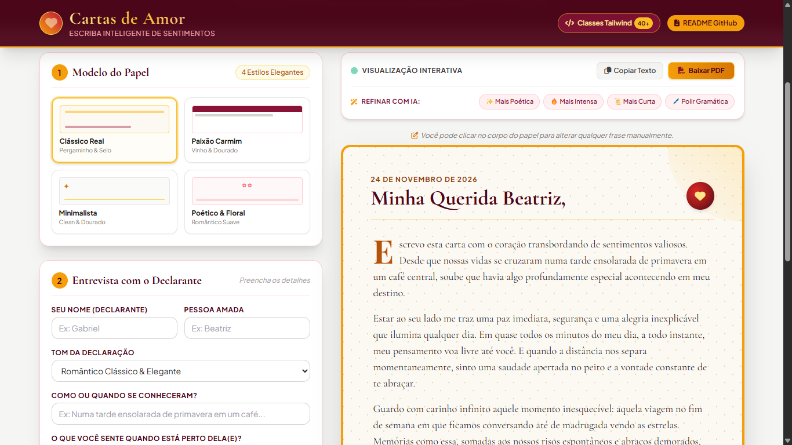
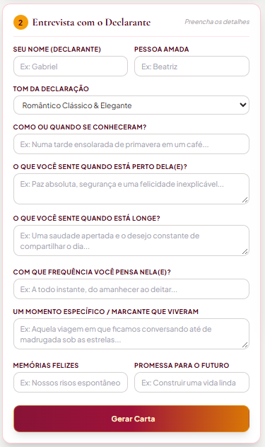
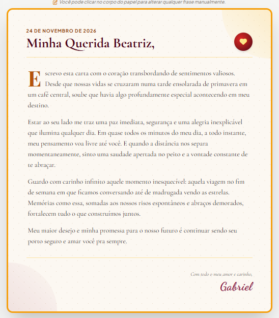
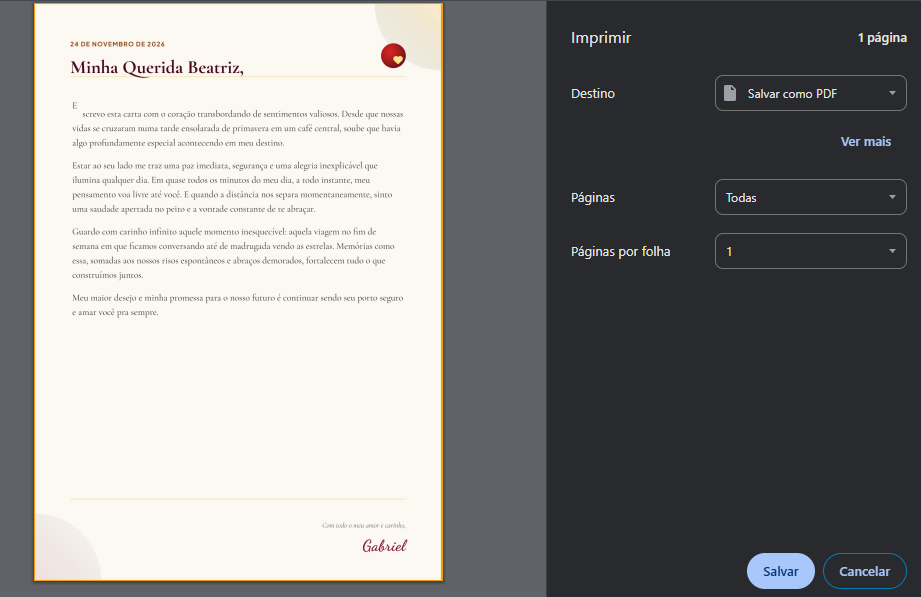
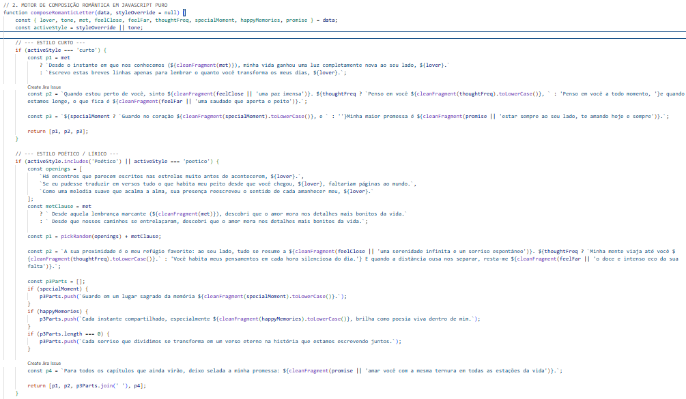
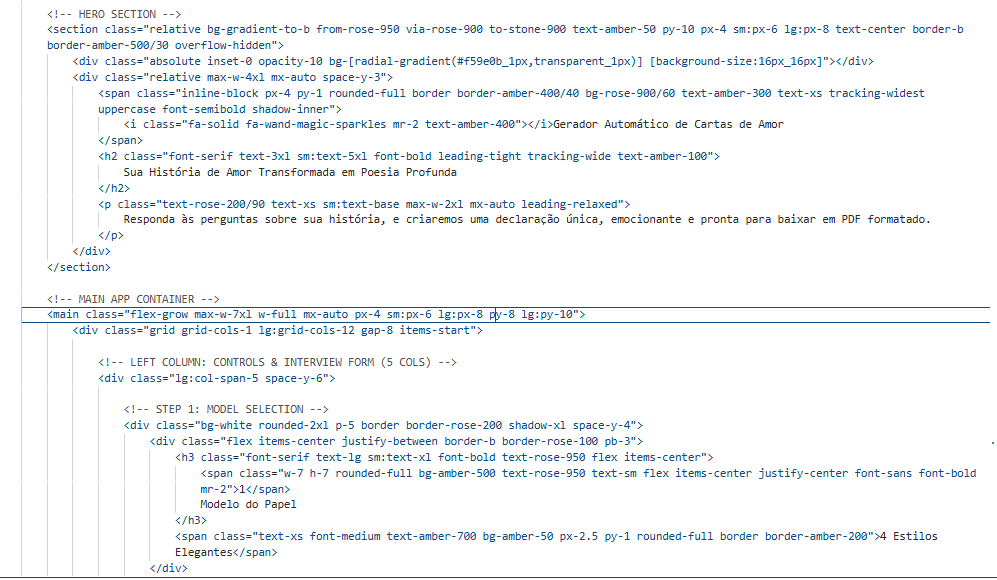

# 💌 Documentação do Projeto: Gerador de Cartas de Amor

> Relatório e documentação de entrega da atividade prática de desenvolvimento Web responsivo utilizando **Tailwind CSS**, **HTML5** e **JavaScript puro**.

---

## 🔗 1. Links do Projeto Desenvolvido

* **Repositório no GitHub:** `https://github.com/Ry4nBR/gerador-de-cartas-de-amor-projeto-tailwind
* **Aplicação em Funcionamento (Vercel):** https://gerador-de-cartas-de-amor-projeto-t.vercel.app/

---

## 👤 2. Identificação do Autor e Tema

* **Aluno / Desenvolvedor:** Ryan Amorim Carvalho
* **Tema da Aplicação:** Site para geração de cartas de amor com entrevista guiada e motor inteligente de composição textual.
* **Paleta de Cores Utilizada:** Cores quentes românticas — Vermelho Carmim (`#4c0519`, `#991b1b`), Ouro Metálico (`#f59e0b`, `#d97706`), Off-White / Pergaminho (`#fcf8f2`) e Branco Puro (`#ffffff`).

---

## 🚀 3. Funcionalidades Implementadas

1. **Motor Inteligente Local em JavaScript (100% Client-Side):** Processa todas as respostas da entrevista diretamente no navegador sem depender de APIs externas ou chaves de servidor, garantindo funcionamento imediato e estável em hospedagens estáticas como a **Vercel**.
2. **Entrevista Guiada com Placeholders Dinâmicos:** Campos de entrada intuitivos com textos de exemplo (`placeholder`) que desaparecem automaticamente ao digitar, coletando sentimentos de proximidade, distância, frequência de pensamentos, memórias marcantes e promessas.
3. **Refinamento Rápido em 1 Clique:** Ferramenta sobre o papel que adapta instantaneamente a carta para 4 variações (*✨ Mais Poética*, *🔥 Mais Intensa*, *📜 Mais Curta* e *🖋️ Polir Gramática*).
4. **4 Modelos Visuais de Papel:** *Clássico Real* (pergaminho com selo de cera), *Paixão Carmim* (vinho e dourado), *Minimalista* e *Poético & Floral*.
5. **Edição Direta no Papel e Exportação em PDF:** Área editável (`contenteditable="true"`) com download em PDF de alta qualidade via `html2pdf.js`.

---

## 📸 4. Registros Visuais (Prints do Código e da Aplicação)

> *Dica: Adicione suas imagens na pasta `./assets/` do repositório e mantenha os caminhos abaixo.*

### 📷 4.1 Prints da Aplicação em Funcionamento

| Visualização Geral da Interface | Entrevista Guiada com Placeholders |
| :---: | :---: |
|  |  |

| Carta Gerada e Refinada no Papel | Download em PDF Formatado |
| :---: | :---: |
|  |  |

### 📷 4.2 Prints do Código Fonte

## ⚙️ Motor de Composição Romântica em JavaScript Puro

Para garantir que a aplicação funcione de maneira instantânea, gratuita e 100% *client-side* (sem necessidade de chaves de API ou servidores externos), foi desenvolvido um motor próprio de composição textual em **JavaScript (ES6+)** por meio da função `composeRomanticLetter()`:

### 🔍 Como o Algoritmo Funciona

* **Desestruturação e Tratamento de Dados:** A função recebe o objeto `data` contendo as respostas da entrevista (`lover`, `met`, `feelClose`, `feelFar`, `thoughtFreq`, `specialMoment`, `happyMemories` e `promise`) e utiliza funções auxiliares como `cleanFragment()` para higienizar a pontuação e evitar repetições de pontos finais.
* **Adaptação Dinâmica de Estilo (`activeStyle`):** Por meio de estruturas condicionais, o algoritmo reorganiza a estrutura narrativa, o vocabulário e a quantidade de parágrafos conforme o tom escolhido pelo usuário (como *Curto*, *Poético/Lírico*, *Apaixonado/Intenso*, *Carinhoso* ou *Clássico*).
* **Variação Natural de Aberturas (`pickRandom`):** Utiliza um seletor aleatório sobre arranjos de frases introdutórias (`openings`), garantindo que cada geração produza uma abertura única e orgânica.
* **Fallbacks Inteligentes:** Caso o usuário deixe algum campo opcional em branco, operadores ternários e valores padrão (`||`) preenchem as lacunas com expressões românticas coerentes, assegurando que a carta final sempre mantenha fluidez literária.

---

## 📸 Estrutura HTML e Estilização com Tailwind CSS

O trecho de código abaixo demonstra a organização semântica em **HTML5** combinada com a abordagem *utility-first* e responsiva do **Tailwind CSS** na construção da interface:

!

### 🔍 Destaques Técnicos do Trecho

* **Semântica e Hierarquia HTML5:** Utilização de tags estruturais como `<section>` (seção de destaque *Hero*), `<main>` (contêiner principal da aplicação), `<h2>`, `<h3>`, `
` e ``, garantindo acessibilidade e clareza na leitura do código.
* **Paleta de Cores Quentes e Gradientes:** Aplicação de tons em vermelho carmim e vinho (`from-rose-950`, `via-rose-900`, `text-rose-950`), dourado (`text-amber-100`, `bg-amber-500`, `border-amber-400/40`) e tons neutros acolhedores (`to-stone-900`, `bg-white`), criando uma identidade visual romântica e sofisticada.
* **Layout Responsivo (Grid e Flexbox):**
  * Uso de **CSS Grid** (`grid grid-cols-1 lg:grid-cols-12 gap-8`) para organizar a tela em coluna única em dispositivos móveis e dividi-la proporcionalmente (`lg:col-span-5`) em telas maiores.
  * Uso de **Flexbox** (`flex items-center justify-between`, `flex-grow`) para alinhamento preciso de títulos, badges e cartões.
* **Tipografia e Espaçamento:** Combinação de fontes serifadas (`font-serif`) e modernas (`font-sans`) com escalas responsivas (`text-3xl sm:text-5xl`), espaçamentos internos padronizados (`px-4 sm:px-6 lg:px-8`, `p-5`, `space-y-6`) e acabamento visual com bordas arredondadas (`rounded-2xl`, `rounded-full`) e sombras (`shadow-xl`).

## 🎨 5. Lista das Classes Tailwind CSS Utilizadas e Suas Funções

Abaixo estão listadas **mais de 40 classes do Tailwind CSS** empregadas na construção do projeto, organizadas por categoria:

### 🎨 Cores e Planos de Fundo (Cores Quentes)
1. `bg-rose-950` — Define o fundo vinho/carmim escuro no cabeçalho, modais e rodapé.
2. `bg-rose-900` — Cor de fundo carmim intenso para botões primários e detalhes da interface.
3. `bg-rose-50` — Fundo tom rosa suave utilizado no modelo de carta Poético & Floral e nos botões de refinamento.
4. `bg-amber-500` — Cor de fundo em tom ouro metálico vibrante para destaques, ícones e botões.
5. `bg-amber-50` — Fundo off-white com tom amarelado sutil para os modelos de carta selecionados.
6. `bg-stone-100` — Fundo neutro e acolhedor de toda a página web.
7. `bg-white` — Fundo branco puro para os cartões de formulário, campos e modais.
8. `bg-gradient-to-r` — Aplica gradiente linear da esquerda para a direita nos botões de ação e títulos.
9. `bg-gradient-to-tr` — Aplica gradiente diagonal para dar profundidade aos selos e ícones.

### 🔤 Tipografia e Estilização de Texto
10. `font-serif` — Aplica a fonte serifada clássica literária (*Cormorant Garamond / Playfair Display*).
11. `font-sans` — Aplica a fonte limpa e moderna para leitura rápida dos botões e campos (*Plus Jakarta Sans*).
12. `font-handwriting` — Fonte estilo caligrafia manuscrita para a assinatura da carta (*Dancing Script*).
13. `text-amber-100` / `text-amber-300` — Cor de texto dourada clara para leitura sobre fundos escuros.
14. `text-rose-950` — Cor de texto carmim escuro de alto contraste para os títulos principais.
15. `text-stone-800` — Cor neutra e legível para o corpo da carta de amor.
16. `text-xs` / `text-sm` / `text-base` — Tamanhos de fonte para rótulos, legendas e corpo de texto.
17. `text-2xl` / `text-3xl` / `text-5xl` — Escala tipográfica para os títulos do Hero e das seções.
18. `font-bold` / `font-semibold` — Pesos de fonte para indicar hierarquia e destaque.
19. `italic` — Estilo itálico para saudações e frases românticas.
20. `tracking-wider` / `tracking-widest` — Espaçamento entre letras para destacar termos em caixas altas.
21. `leading-relaxed` / `leading-tight` — Entrelinhas ajustadas para leitura agradável.
22. `bg-clip-text` — Recorta o fundo de gradiente no formato exato das letras do título.

### 📐 Espaçamentos, Dimensões e Bordas
23. `p-3` / `p-5` / `p-8` / `p-12` — Padding interno em múltiplos tamanhos.
24. `px-4` / `py-2` / `py-3.5` — Preenchimento horizontal e vertical para botões de ação.
25. `space-y-3` / `space-y-4` / `space-y-6` — Espaçamento vertical automático entre elementos empilhados.
26. `gap-3` / `gap-8` — Espaçamento em malhas Grid e Flexbox.
27. `w-full` / `max-w-4xl` / `max-w-7xl` — Larguras responsivas e limites de contêineres centrais.
28. `min-h-screen` / `min-h-[650px]` — Altura mínima da tela e da folha da carta de amor.
29. `rounded-xl` / `rounded-2xl` / `rounded-full` — Arredondamento suave de cantos de cards e botões.
30. `border` / `border-2` / `border-4` — Definidores de espessura de contornos ornamentais.
31. `border-amber-400` / `border-rose-200` — Cores ornamentais douradas e carmim para bordas.

### 🎭 Profundidade, Efeitos e Flexbox/Grid
32. `shadow-md` / `shadow-xl` / `shadow-2xl` — Efeitos de sombra projetada de alta qualidade.
33. `ring-2` / `ring-amber-400/30` — Efeito de anel de realce no modelo de papel ativo.
34. `flex` / `flex-col` / `flex-wrap` — Alinhamento flexível e quebra de elementos.
35. `items-center` / `justify-between` / `justify-center` — Centralização e distribuição de espaço flex.
36. `grid` / `grid-cols-1` / `grid-cols-2` — Malha estrutural para formulários e seleção de modelos.
37. `lg:grid-cols-12` — Layout em 12 colunas no desktop (5 colunas para formulário, 7 para a carta).
38. `relative` / `absolute` / `fixed` / `sticky` — Posicionamento de modais, fundos e cabeçalho fixo.
39. `top-0` / `inset-0` / `z-10` / `z-30` / `z-50` — Ordem de empilhamento de camadas e fixação superior.
40. `backdrop-blur-md` — Efeito de vidro fosco no cabeçalho e nos modais.
41. `animate-pulse` / `animate-spin` — Animações nativas para o coração e o carregamento visual.
42. `transition-all` / `duration-300` — Transições suaves ao passar o mouse ou interagir.
43. `hover:bg-amber-400` / `hover:scale-105` — Efeitos interativos para hover em botões e cards.

---

## ⚙️ 6. Como Executar e Testar o Projeto

1. Acesse o link do deploy na **Vercel** ou faça o clone deste repositório.
2. Abra o arquivo `index.html` em qualquer navegador web moderno (Chrome, Edge, Firefox ou Safari).
3. Preencha os campos na seção **Entrevista com o Declarante** (as dicas desaparecem automaticamente ao digitar).
4. Clique em **"Gerar Carta"** e teste os botões de refinamento rápido (*Mais Poética*, *Mais Intensa*, *Mais Curta* e *Polir Gramática*).
5. Escolha entre os 4 **Modelos do Papel**, edite qualquer trecho diretamente na folha se desejar e clique em **"Baixar PDF"**.

---

## ✍️ Assinatura do Autor

Desenvolvido com dedicação por:

**Ryan Amorim Carvalho**  
*Projeto de Desenvolvimento Web & Interface Responsiva com Tailwind CSS*
